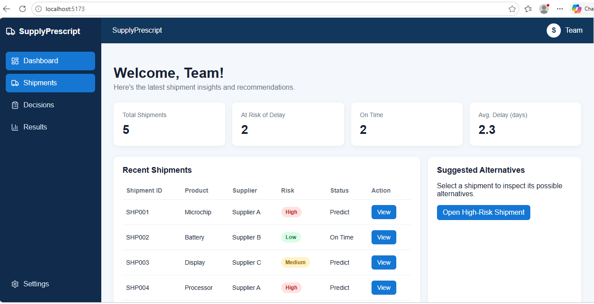
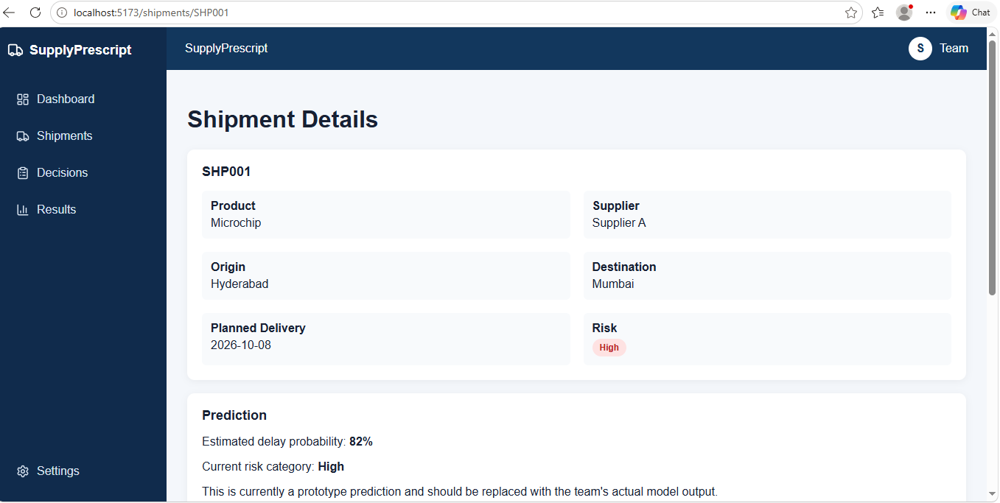
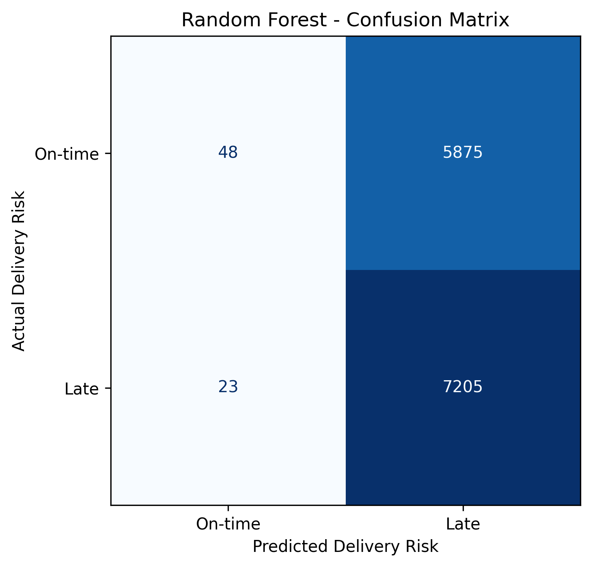
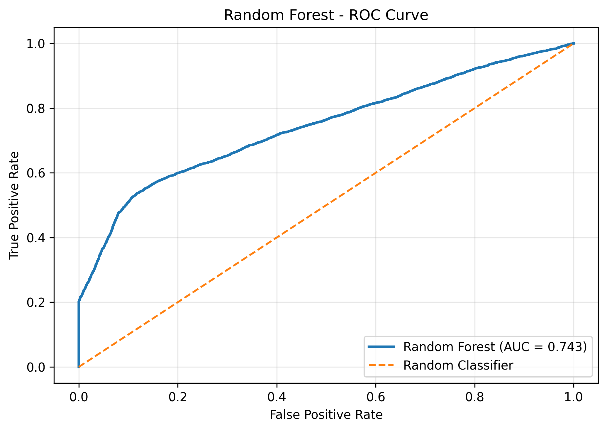

# SupplyPrescript

**Closed-Loop Prescriptive Analytics for Supply Chain Decisions**

SupplyPrescript is a supply-chain decision-support system designed to identify shipments at risk of late delivery and help users evaluate alternative actions. It combines machine learning-based risk prediction, optimization, and an interactive dashboard to support informed logistics decisions.

## Project Overview

Late deliveries can affect customer satisfaction, operational efficiency, and logistics costs. SupplyPrescript aims to address this challenge by:

- Predicting potential late-delivery risks.
- Evaluating alternative shipment actions.
- Comparing possible cost and time trade-offs.
- Displaying shipment information through an interactive dashboard.
- Recording selected decisions and supporting outcome evaluation.

## Project Workflow

1. **Data Preparation:** Clean, inspect, and transform shipment-level data into an order-level dataset.
2. **Risk Prediction:** Train a Random Forest classification model to estimate late-delivery risk.
3. **Optimization:** Generate alternative actions based on available shipment information and operational constraints.
4. **Backend Integration:** Handle prediction, optimization, and application data through backend APIs.
5. **Frontend Dashboard:** Present shipment risk, details, and alternative actions.
6. **Decision Support:** Help users evaluate and select suitable actions.

## Technology Stack

| Area | Technologies |
|---|---|
| Programming Language | Python, JavaScript |
| Data Processing | Pandas |
| Machine Learning | Scikit-learn, Random Forest |
| Data Visualization | Matplotlib |
| Backend | FastAPI |
| Frontend | React, Vite |
| API Communication | Axios |
| Version Control | Git, GitHub |

## Application Screenshots

### Main Dashboard

The dashboard provides an overview of shipment information and delivery-risk insights.



### Shipment Details

The shipment details interface provides shipment-level information to support operational decisions.



## Machine Learning – Data Preparation & Prediction

The machine learning component focuses on preparing order-level data and predicting potential late-delivery risks.

### Data Preparation

- Inspected and prepared the original shipment dataset.
- Cleaned and transformed item-level records into order-level records.
- Aggregated relevant order information.
- Prepared numerical and categorical features for model training.
- Created the target variable for late-delivery risk prediction.

### Final Prediction Model

A Random Forest Classifier was used for the final prediction model.

**Model configuration:**
- Estimator: Random Forest
- Number of trees: 200
- Maximum depth: 12
- Minimum samples per leaf: 5
- Random state: 42
- Classification threshold: 0.30

### Model Evaluation

The final model was evaluated on a chronological test set containing 13,151 orders.

| Evaluation Metric | Result |
|---|---:|
| Accuracy | 55.15% |
| Precision | 55.08% |
| Recall | 99.68% |
| F1 Score | 70.96% |
| ROC-AUC | 74.30% |

#### Confusion Matrix

The confusion matrix shows the actual and predicted delivery-risk classifications.



#### ROC Curve

The ROC curve illustrates the model's ability to distinguish between the two delivery-risk classes across different classification thresholds.



**Model Evaluation Note:** The model achieves high recall but also produces a considerable number of false positives. Therefore, its predictions should be treated as risk indicators to support operational decisions, not as guaranteed delivery outcomes.

## Project Modules

| Module | Responsibility |
|---|---|
| Data Preparation & Prediction | Data cleaning, feature preparation, model training, and risk prediction |
| Optimization | Alternative shipment actions and trade-off evaluation |
| Backend & Database | API development, data handling, and decision write-back |
| Frontend & Dashboard | User interface and shipment visualization |

## Team Members

| Team Member | Responsibility |
|---|---|
| Arshin Sheikh | Team Leader – Data Preparation & Prediction |
| Abhishek Guddetwar | Optimization & Alternative Actions |
| Chaitra Kelaginamani | Backend & Database |
| Chinna Bairi Shravani | Frontend & Dashboard |

## Project Structure

```text
SupplyPrescript/
│
├── backend/
├── documentation/
├── Images/
├── notebooks/
├── optimization/
├── src/
├── frontend/
├── .gitignore
└── README.md
```

## Getting Started

### 1. Clone the Repository

```bash
git clone https://github.com/arshinsheikh27-eng/SupplyPrescript.git
cd SupplyPrescript
```

### 2. Run the Backend

```bash
cd backend
pip install -r requirements.txt
python -m uvicorn main:app --reload
```

### 3. Run the Frontend

Open another terminal:

```bash
cd frontend
npm install
npm run dev
```

Use the local URL displayed by Vite to access the application.

## Repository

GitHub: https://github.com/arshinsheikh27-eng/SupplyPrescript

---

**SupplyPrescript – Turning Shipment Risk Predictions into Actionable Supply Chain Decisions.**